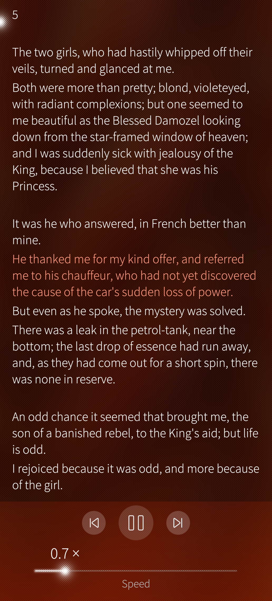
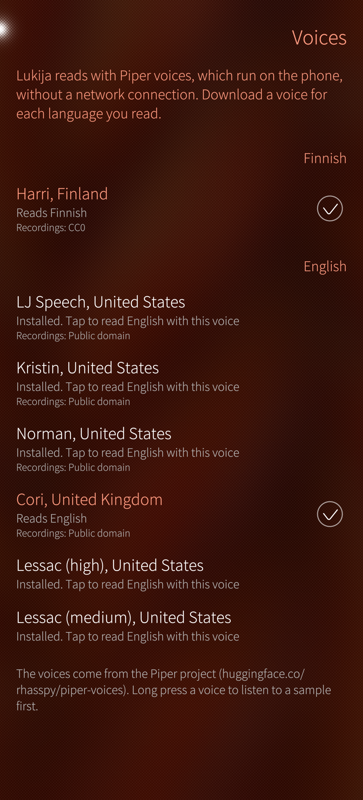

# Lukija

Lukija reads PDF files aloud on Sailfish OS, with neural voices that run on the phone. It's made for ebooks and academic articles in Finnish and English.

- Reads with [Piper](https://github.com/OHF-Voice/piper1-gpl) voices, offline: once a voice is downloaded, no network or account is needed.
- Remembers where you stopped in each document, and shows how far you've got.
- Keeps reading with the screen off. Play, pause and skip from the lock screen, the app cover, or headset and car buttons.
- Pauses for calls and when headphones or Bluetooth audio disconnect, and carries on after a short interruption such as a notification sound.
- Speed from 0.5× to 2×. Tap a sentence to read from there; long press the previous or next button to skip a paragraph.

<p>
  
  
</p>

**Status:** version 0.1.0, the first public release. Tested on the Jolla Phone with Sailfish OS 5.2.

## Installing

Lukija runs on 64-bit ARM (aarch64) phones with Sailfish OS 5.

1. Download `harbour-lukija-0.1.0-*.aarch64.rpm` from the [latest release](https://github.com/l1pi/lukija/releases/latest) with the phone's browser.
2. In Settings, allow installing untrusted software.
3. Open the downloaded file, for example from the browser's downloads or the file manager, and install it.

Or, with developer mode on: `devel-su pkcon install-local harbour-lukija-0.1.0-*.aarch64.rpm`.

## Voices

On first start, Lukija asks you to download a voice: tap the banner, or pull down on the library and choose **Voices**. Download one for each language you read, about 60 MB each:

| Language | Voice | Recordings licensed as |
|---|---|---|
| Finnish | Harri | CC0 |
| English (US) | LJ Speech (the default), Kristin, Norman | public domain |
| English (UK) | Cori | public domain |

Long press a voice to listen to a sample first. With several voices for a language, tap one to read that language with it.

The voices come from [rhasspy/piper-voices](https://huggingface.co/rhasspy/piper-voices). Lukija only offers voices trained on freely licensed recordings. Harri was fine-tuned from Piper's lessac voice, whose recordings are licensed for research.

## Known limitations

- Running headers, page numbers, footnotes and reference lists are read aloud. Article clean-up is planned.
- Scanned PDFs without a text layer can't be read. Lukija tells you when that's the case.
- Opening a PDF from another app ("Open with") isn't reliable yet: if Lukija is already running, the file isn't opened.
- The user interface is in English only.

Report problems on the [issue tracker](https://github.com/l1pi/lukija/issues).

## Building on desktop

Arch / CachyOS:

```sh
sudo pacman -S --needed cmake ninja qt5-base qt5-multimedia poppler-qt5
cmake -S . -B build -G Ninja
cmake --build build
```

The first build downloads [libpiper](https://github.com/OHF-Voice/piper1-gpl) (Piper TTS), espeak-ng and a prebuilt onnxruntime, with pinned checksums, and builds libpiper with a small patch (`3rdparty/patch-libpiper.cmake`). Builds without network access can point `LUKIJA_PIPER_URL`, `LUKIJA_ESPEAK_URL`, `LUKIJA_SONIC_URL` and `LUKIJA_ONNXRUNTIME_URL` at local copies. Configure with `-DLUKIJA_WITH_PIPER=OFF` to build without Piper.

Keep the build directory's path short, under about 60 characters: espeak-ng's build can't handle long paths. CMake stops with a message if the path is too long.

`core/` must stay compatible with Qt 5.6, the Qt version on Sailfish OS, even though desktop builds use Qt 5.15. The Sailfish build catches newer APIs.

## Building for Sailfish OS

With the [Sailfish SDK](https://docs.sailfishos.org/Tools/Sailfish_SDK/) installed:

```sh
mkdir build-sfos && cd build-sfos
sfdk -c target=SailfishOS-5.1.0.11-aarch64 build ..
```

This builds `RPMS/harbour-lukija-*.aarch64.rpm` (the app, with libpiper and onnxruntime bundled) and `harbour-lukija-cli` (the command-line tool). To install over USB with developer mode on:

```sh
scp RPMS/*.rpm defaultuser@192.168.2.15:/tmp/
ssh defaultuser@192.168.2.15 'devel-su pkcon -y install-local /tmp/harbour-lukija-*.rpm'
```

The app downloads its voices itself.

To build without network access, download the third-party sources first and point rpmbuild at them:

```sh
mkdir -p build-sfos && rpm/fetch-sources.sh build-sfos/sources
cd build-sfos && sfdk -c target=SailfishOS-5.1.0.11-aarch64 build .. -- --define "_sourcedir $PWD/sources"
```

## Voices on the desktop

`lukija-cli` uses the same voices directory as the app. To fetch voices on a PC:

```sh
tools/fetch-voice.sh                        # fi_FI-harri-medium and en_US-ljspeech-medium
tools/fetch-voice.sh en_GB-alba-medium      # any id from huggingface.co/rhasspy/piper-voices
```

Voices go to `~/.local/share/io.github.l1pi/harbour-lukija/voices/`. The voices the app offers are listed, with pinned checksums, in `tts/voicecatalog.cpp`.

## lukija-cli

```sh
build/tools/lukija-cli/lukija-cli dump paper.pdf        # the text as it will be spoken
build/tools/lukija-cli/lukija-cli annotate paper.pdf    # layout blocks and their classification
build/tools/lukija-cli/lukija-cli speak paper.pdf       # read aloud; voice chosen by language
build/tools/lukija-cli/lukija-cli speak book.pdf --page 12 --speed 1.2
build/tools/lukija-cli/lukija-cli speak paper.pdf --count 20 -o sample.wav
build/tools/lukija-cli/lukija-cli voices
```

`speak` prints each sentence as it's spoken and, at the end, the synthesis real-time factor. `LUKIJA_PIPER_THREADS` sets the number of synthesis threads (default 2).

## Layout

```
core/      PDF text extraction and the text pipeline (plain Qt + poppler-qt5)
tts/       TTS engine interface, Piper engine, synthesis queue, voice lookup and catalogue
audio/     PCM helpers and AudioSink (QAudioOutput)
app/       playback controller, library database, voice downloads, QML models; main.cpp is the Sailfish app
qml/       Silica UI
rpm/       RPM spec and changelog; fetch-sources.sh for builds without network
tools/     lukija-cli, fetch-voice.sh
3rdparty/  libpiper build (espeak-ng, onnxruntime)
docs/      screenshots
```

## Licence

GPL-3.0-or-later. See [LICENSE](LICENSE).

The app bundles libpiper (GPL-3.0) with espeak-ng (GPL-3.0) built in, and onnxruntime (MIT). Their licences are installed in `/usr/share/harbour-lukija/licenses/`. The voices are downloaded separately; their licences are above.
